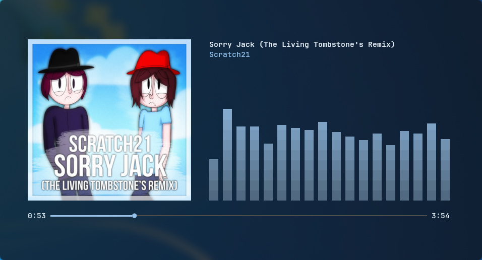

# matchyy

Mostra no terminal a música que está tocando: a capa do álbum renderizada como imagem (igual ao fastfetch no kitty), título e artista, um visualizador de barras que reage ao som e uma barra de progresso com o tempo atual e a duração.



## Requisitos

- Linux com **MPRIS** (Spotify, mpv, navegadores etc.) e `playerctl`
- **PipeWire ou PulseAudio** com `parec` (pacote `libpulse`), para o visualizador
- `curl`, para baixar capas que vêm por URL
- Um terminal com o **protocolo gráfico do kitty** (kitty, WezTerm, Ghostty, Konsole)
- Rust 1.88 ou mais novo, só se for compilar

## Instalação

### Com o script (recomendado)

```sh
curl -fsSL https://raw.githubusercontent.com/MarceloAntonio/matchyy/main/install.sh | sh
```

O script:

- descobre a última release no GitHub
- baixa o binário e o `SHA256SUMS` só por HTTPS e confere o hash antes de instalar
- roda o binário baixado para ter certeza de que funciona na sua máquina
- instala em `~/.local/bin` (ou em `MATCHYY_DIR`, se você definir) com troca atômica, sem deixar arquivo pela metade
- se o matchyy já estiver instalado, avisa quando ele já está na última versão; se estiver desatualizado, **pergunta antes** de atualizar
- avisa se a pasta não está no `PATH` ou se faltam `playerctl` ou `parec`

Rodar o mesmo comando de novo serve para atualizar. Se preferir ler o script antes de rodar:

```sh
curl -fsSLO https://raw.githubusercontent.com/MarceloAntonio/matchyy/main/install.sh
less install.sh
sh install.sh
```

### Baixando o binário com curl

O binário é estático (musl) e roda em qualquer Linux x86_64.

```sh
cd /tmp
curl -fsSLO https://github.com/MarceloAntonio/matchyy/releases/latest/download/matchyy-x86_64-linux
curl -fsSLO https://github.com/MarceloAntonio/matchyy/releases/latest/download/SHA256SUMS
sha256sum -c SHA256SUMS          # tem que mostrar: matchyy-x86_64-linux: OK
install -Dm755 matchyy-x86_64-linux ~/.local/bin/matchyy
```

### Compilando

```sh
cargo install --git https://github.com/MarceloAntonio/matchyy
```

## Uso

```sh
matchyy                  # padrão: cores tiradas da capa
matchyy -tc              # usa a cor do tema do terminal
matchyy -p spotify -mr   # só o Spotify, espectro espelhado
matchyy -j               # imprime a música atual em JSON e sai
```

| Opção | O que faz |
|---|---|
| `-tc`, `--terminal-color` | usa a cor do tema do terminal (ciano da paleta) em vez da cor da capa |
| `-p`, `--player <nome>` | segue só esse player; os nomes aparecem em `playerctl -l` |
| `-m`, `--monitor <fonte>` | captura o áudio dessa fonte em vez de `@DEFAULT_MONITOR@`; as fontes aparecem em `pactl list short sources` |
| `-f`, `--fps <n>` | quadros por segundo (padrão 30); menos fps gasta menos CPU |
| `-j`, `--json` | imprime status, título, artista, álbum, posição, duração e capa em JSON e sai |
| `-mr`, `--mirror` | espelha o espectro: graves no centro, agudos nas pontas |
| `-sn`, `--sensitivity <x>` | multiplica a altura das barras (ex.: `1.5` ou `0.7`) |
| `-gv`, `--gravity <x>` | velocidade de queda das barras (padrão `1.0`) |
| `-pk`, `--peaks` | marca o pico de cada barra, que cai devagar |
| `-i`, `--invert` | barras crescem de cima para baixo |
| `-d`, `--dense` | barras de 1 coluna, sem espaço entre elas |

Todas vêm desligadas, e sem nenhuma opção o matchyy funciona com os valores padrão. `matchyy --help` mostra a mesma lista.

**Teclas:** `espaço` play/pause · `n` ou `→` próxima · `p` ou `←` anterior · `q` ou `Esc` sai.

## Como o código funciona

O programa inteiro está em `src/main.rs`, e cada parte tem uma função só.

1. **Opções** (`parse_args`, `Opts`, `HELP`): lê os argumentos e guarda tudo num `OnceLock` global, que é lido por `opts()`. O texto do `--help` é a constante `HELP`.
2. **Player** (`poll_player`, `read_track`): uma thread chama `playerctl metadata --format …` a cada 400 ms e guarda o resultado em `Shared`. Entre uma leitura e outra, a posição da música é interpolada com o `Instant` da última leitura.
3. **Capa** (`load_cover`): quando o `mpris:artUrl` muda, a capa é baixada (com `curl` para `http(s)://` ou lida do disco para `file://`), cortada em 400×400 e convertida para PNG. A cor de destaque é a média dos pixels, com mais saturação e brilho.
4. **Áudio** (`spawn_audio`): o `parec` grava o monitor da saída de som em PCM 16 bits mono a 44,1 kHz. Uma thread guarda as últimas 4096 amostras numa `VecDeque`.
5. **Espectro** (`bands`): aplica uma janela de Hann, faz a FFT (`rustfft`) e divide a faixa de 50 Hz a 12 kHz em faixas logarítmicas. Cada faixa vira dB, com +3 dB por oitava para compensar o grave, e depois é normalizada para 0..1 entre `DB_FLOOR` e `DB_CEIL`.
6. **Desenho** (`run`): a cada quadro, monta todo o conteúdo num buffer e escreve de uma vez, dentro de uma atualização sincronizada (`CSI ?2026`), para não piscar. A capa só é reenviada quando muda ou quando a janela muda de tamanho (`kitty_image`, em blocos base64 de 4096 bytes). Texto, barras e progresso são reescritos no lugar com `CSI K`, sem limpar a tela.
7. **Layout** (`layout`): usa o tamanho da janela em pixels para descobrir a proporção das células e manter a capa quadrada.

### Ajuste fino

As constantes no topo de `main.rs` controlam o visualizador. Se as barras viverem baixas, baixe `DB_CEIL`; se viverem no teto, suba. `FALL` controla a queda e `TILT_DB_PER_OCT` o equilíbrio entre graves e agudos.

## Testes

```sh
cargo test
```

Os testes conferem que uma senoide de 1 kHz cai na faixa certa, que silêncio dá zero e que base64, percent-decoding, JSON e as opções de linha de comando funcionam.

## Licença

[Apache 2.0](LICENSE). Para contribuir, veja [CONTRIBUTING.md](CONTRIBUTING.md).
